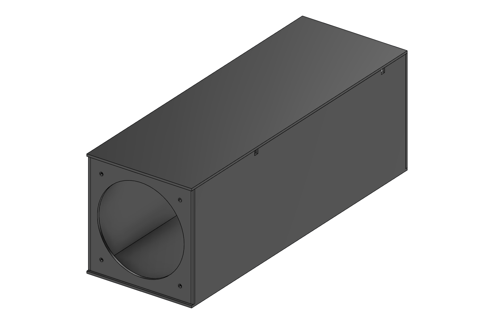

# Cooling enclosure CAD

**27 November 2026.** The Fusion assembly contains the base, vented intake plate, fan end panel, and removable lid. The assembled shell is approximately **400 × 140 × 146 mm** (length × width × height).

## CAD files and views

| Part | Model details | Editable Fusion file | Image |
| --- | --- | --- | --- |
| Enclosure base | 400 × 140 mm footprint, 3 mm nominal floor and side walls, two 6 × 6 mm cable notches on one wall | [F3D](cad/enclosure-base.f3d) | [Base](images/enclosure-base.png) |
| Fan end panel | 140 × 140 × 3 mm, Ø116 mm exhaust opening, four Ø4.5 mm mounting holes | [F3D](cad/fan-end-panel.f3d) | [Fan panel](images/fan-end-panel.png) |
| Intake plate | 140 × 140 × 3 mm, sixteen 50 × 12 mm vents in two columns of eight | [F3D](cad/intake-plate.f3d) | [Intake plate](images/intake-plate.png) |
| Removable lid | 400 × 140 × 3 mm plate | [F3D](cad/removable-lid.f3d) | [Lid](images/removable-lid.png) |
| Cooling enclosure assembly | All four parts in their saved positions | [Fusion archive](cad/cooling-enclosure-assembly.f3z) · [STEP](cad/cooling-enclosure-assembly.step) | [Exhaust end](images/assembly-exhaust-end.png) · [Intake end](images/assembly-intake-end.png) · [Lid off](images/assembly-lid-off.png) |

Use the F3Z to bring the linked assembly and its parts into Fusion. Use the four F3D files to open the parts individually, or the STEP file to inspect the assembled geometry in another CAD viewer.

## Airflow and cable routing

The planned airflow goes from the vented intake past the Arduino and breadboard, through the heatsink area, and out the fan end. The gold power resistor is the planned heat load. The metal temperature probe hangs in the air near the heatsink to measure air temperature.

Both cable notches open at the top edge so the cables can be laid in with the lid off. The USB notch is on the intake side and the power-supply notch is nearer the fan. The USB cable connects the Arduino Uno to the laptop for programming and monitoring. The external supply powers the fan, and the heat load needs its own rated power connection.

## Checks before fabrication and testing

- The fan panel is recessed about 3 mm in the saved assembly. Check that this leaves enough room for the physical fan and its mounting hardware. The intake plate sits flush.
- Verify that the actual USB and power cables fit the notches under the lid. Decide how the lid, end panels, boards, heatsink, and probe will be secured.
- Confirm the fabrication method and material for the 400 mm base and lid. Dry-fit the parts and confirm the fan draws air in through the intake and out through the fan panel.
- Verify the resistor and supply ratings before powering the heat load. Run the enclosed prototype and record air temperature and fan response under load.
