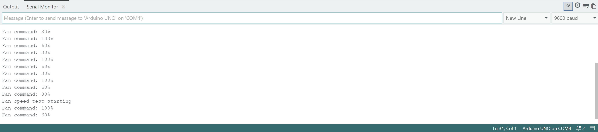

# Standalone fan PWM test

Documentation added: 26 October 2026. The hardware test was performed on the builder's laptop; the supplied Serial Monitor capture is from that laptop. The test was not rerun on the desktop while preparing this record.

## Objective

Demonstrate that an Arduino Uno can command a four-wire PC fan at several PWM settings through an NPN transistor interface, independently of the temperature sensor.

## Hardware and setup

- ELEGOO Uno R3, powered by USB.
- ARCTIC four-wire fan, labelled 12 V, 0.1 A.
- External power adapter, labelled 12 V, 2 A. The builder measured +12.29 V at the output before the fan test, without the fan connected.
- 2N3904 NPN transistor, base resistor and base-to-ground pull-down resistor, breadboard and jumper wires.
- Fan power supplied directly by the external adapter. Arduino ground, adapter negative and transistor emitter share a common ground.
- Arduino D9 drives the transistor base through the base resistor. The collector connects to the fan's PWM control input. The transistor pulls that input low when on; the fan's internal pull-up allows it to go high when the transistor is off.
- Fan tachometer output is not read in this test.

The firmware compensates for the transistor's inverted signal. The fan remains connected to its 12 V supply while the separate PWM input carries the control signal.

## Firmware

[fan_test.ino](../../../fan_test/fan_test.ino) is a copy of the builder's saved sketch, without functional changes.

Timer1 uses a top value of 639 and a prescaler of 1. With the Uno's nominal 16 MHz clock, the calculated PWM frequency is `16,000,000 / (639 + 1) = 25,000 Hz`. This frequency has not been measured with an oscilloscope.

The sketch repeats:

| Stage | Fan PWM command | Hold time |
|---|---:|---:|
| 1 | 100% | 15 seconds |
| 2 | 60% | 15 seconds |
| 3 | 30% | 15 seconds |

One complete command sequence lasts 45 seconds. Serial output uses 9600 baud. Timer1 continues producing PWM during each delay.

## Observations and limits

The builder reported that the fan spun smoothly during the initial direct-power check and that the subsequent PWM test worked across all three stages. Two video recordings were supplied as evidence. The Serial Monitor capture shows the commanded percentages repeating.

This is a qualitative demonstration of fan response. No tachometer readings, measured duty cycles, measured PWM frequency, airflow measurements or cooling performance data were recorded. The Serial Monitor reports commands, not feedback from the fan. The zero-percent branch in the sketch was not part of the three-stage test sequence.

## Evidence

- [Video showing the fan and setup](videos/fan-test-with-setup.mov)
- [Closer fan-test video](videos/fan-test-without-setup.mov)

The original MOV recordings are retained. GitHub may offer them as downloads rather than playing them inside this document.

## Next work

Read the tachometer output to measure RPM at each command, then integrate fan control with temperature sensing. Enclosure cooling tests will follow once a controlled heat source and physical layout are ready.
