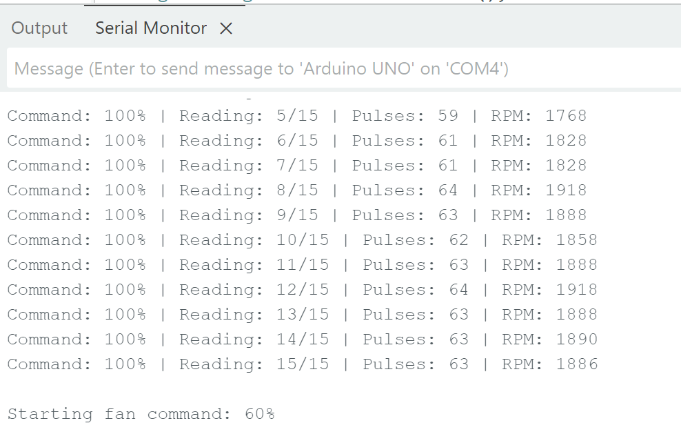
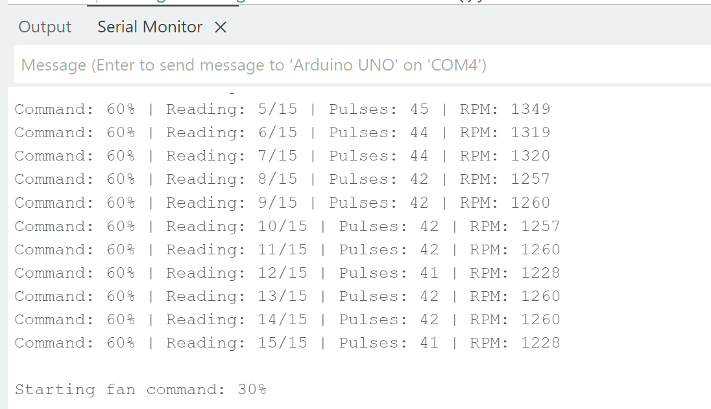
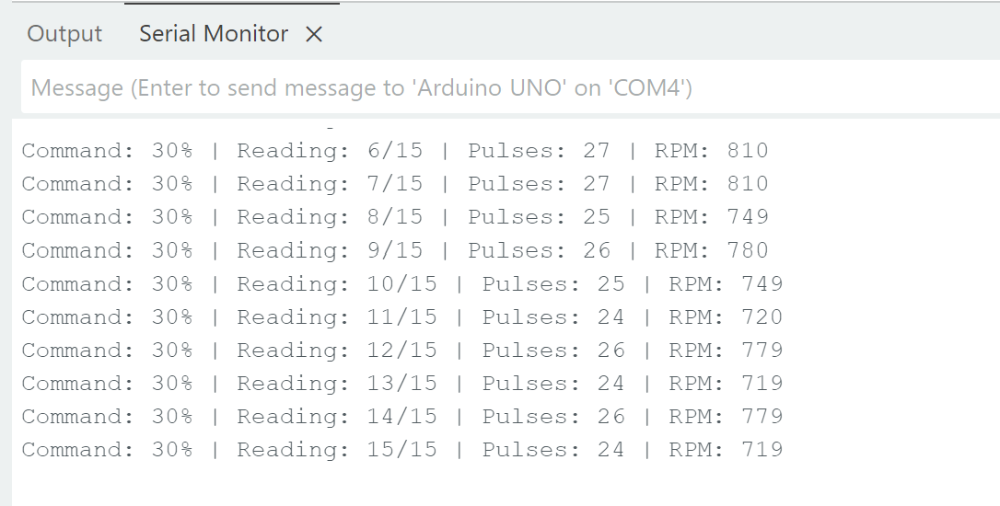

# Fan PWM and tachometer test

Hardware test: 21 November 2026. Code review and documentation: 22 November 2026.

## Purpose and procedure

Add rotation feedback to the working PWM fan circuit, and compare pulse rates at 100%, 60% and 30% commands. The fan receives continuous external 12 V power. D9 controls the PWM input through the NPN interface. D2 receives the tachometer output with a 10 kOhm pull-up to Arduino 5 V.

The sketch takes 15 readings per stage, approximately one second apart, using the actual elapsed milliseconds in the RPM conversion. Readings 11-15 were selected consistently for the comparison to reduce the influence of speed changes after a new command. This selection does not establish that every sample represents fully settled speed.

## Evidence and transcription

The original Serial Monitor screenshots are retained below. `readings-11-15.csv` transcribes only the final five visible readings per command, not a complete raw serial log. Each stage's samples come from its supplied screenshot; the captures alone do not establish that all three belong to one uninterrupted sequence.

| Command | Mean displayed RPM | Minimum | Maximum | Samples |
|---|---:|---:|---:|---:|
| 100% | 1894.0 | 1886 | 1918 | 5 |
| 60% | 1247.2 | 1228 | 1260 | 5 |
| 30% | 743.2 | 719 | 779 | 5 |

At 60%, the mean was about 65.9% of the full-command mean; at 30%, about 39.2%. A command's duty cycle is not a guaranteed percentage of maximum mechanical speed. The declining pulse rates demonstrate speed response, not a calibrated RPM accuracy claim.

### 100% command

### 60% command

### 30% command

## Measurement limits

- Direct measurement: falling-edge pulse counts over timed intervals.
- Conversion assumption: two pulses per mechanical revolution. Not independently confirmed for this exact fan.
- No optical-tachometer comparison or oscilloscope verification has been performed.
- For an approximately one-second window and two pulses per turn, one extra counted pulse changes calculated RPM by about 30. This is count resolution, not a verified error bound.
- Screen values are rounded to whole RPM. Means summarize those displayed values; they do not imply corresponding measurement precision.
- Smaller timing differences explain why identical pulse counts can print slightly different RPM values.
- The 0% branch is present in firmware but was not tested in this sequence.

## Next validation

Confirm pulses per revolution using exact-model documentation or an independent speed measurement. Capture a complete serial log, repeat the stages and quantify repeatability. Inspect PWM and tachometer waveforms with the university oscilloscope when available. Then integrate the temperature sensor; D2 is occupied by the tachometer, so the sensor data pin will need reassignment.

[Firmware](../../../fan_rpm_test/fan_rpm_test.ino) | [Wiring](../../fan-rpm-wiring.md)
