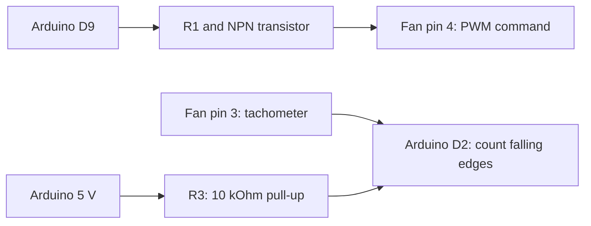
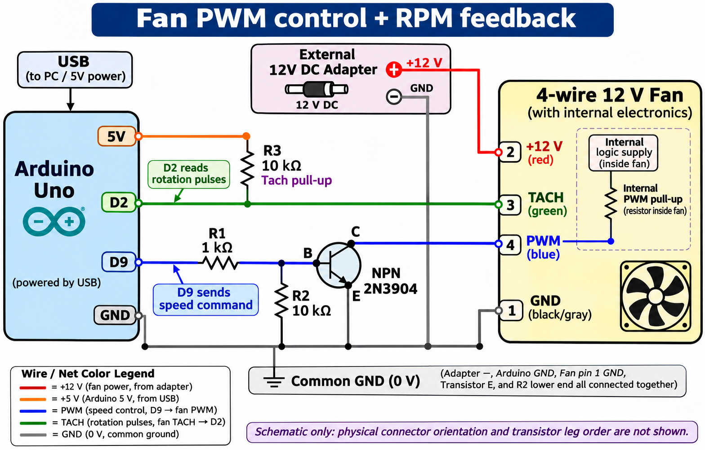

# Fan control and tachometer wiring

Target: ELEGOO Uno R3 / ATmega328P and the project's ARCTIC P12 PWM PST four-wire fan.

| Connection | Destination |
|---|---|
| Adapter +12 V | Fan pin 2, power |
| Adapter negative | Common ground |
| Fan pin 1 | Common ground |
| Arduino GND | Common ground |
| Arduino D9 | R1, 1 kOhm, then 2N3904 base |
| 2N3904 emitter | Common ground |
| 2N3904 collector | Fan pin 4, PWM input |
| R2, 10 kOhm | Transistor base to common ground |
| Fan pin 3, tachometer | Arduino D2 |
| R3, 10 kOhm | D2/tachometer junction to Arduino 5 V |

The Arduino is USB-powered. The external adapter supplies fan motor power. The 5 V and 12 V positive supplies are not joined. Disconnect both power sources before changing wiring. D2 must not also carry the temperature-sensor data signal in this standalone test.

## Separate command and feedback paths

The external transistor pulls the fan PWM input low or releases it. The fan's internal PWM pull-up brings that input high when released. This circuit inverts D9's duty cycle, which the firmware compensates for.

The tachometer is a different signal. R3 provides its HIGH level between the fan's LOW pulses. It does not connect to D9, the transistor base or the transistor collector. The tach junction is not connected directly to ground. R1 limits base current; R2 provides a defined OFF state when the Arduino output is floating.

Identify physical connector positions from [ARCTIC's official pinout](https://www.arctic.de/media/42/84/78/1693306001/Spec_Sheet_P12_PWM_PST_EN.pdf). Wire colours in the schematic identify nets, not the actual black fan cables. Transistor B/C/E labels identify connections, not physical leg order.

The schematic is an illustrative generated drawing. Crossings without junction dots are not connections; the connection table above is the authoritative wiring list.
