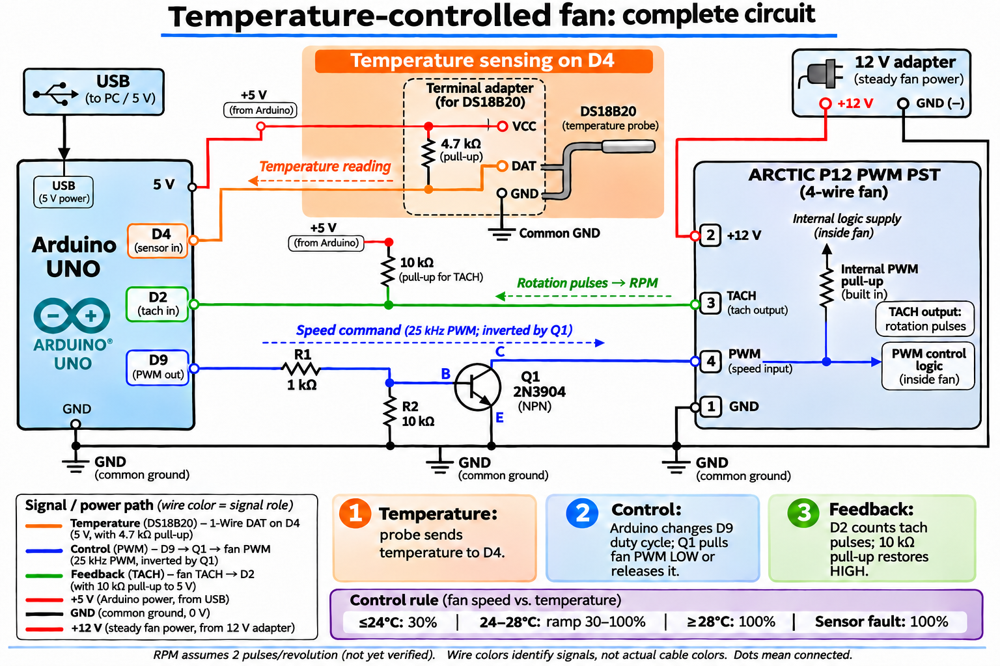

# Integrated temperature, PWM and tachometer wiring

Tested on 24 November 2026 with an ELEGOO Uno R3, DS18B20 probe and ARCTIC P12 PWM PST fan. This is the controller circuit used for the bench tests. Enclosure construction and the dummy heat-load setup are still pending.

The diagram is an AI-generated explanatory schematic, checked against the connections below. It is not a breadboard placement guide or a photograph of test evidence. Colors identify signal roles rather than actual cable colors. All ground symbols represent the same shared ground. The 25 kHz label is calculated from firmware settings, not measured with an oscilloscope.

The 27 November diagram correction makes the sensor VCC junction explicit and shows the fan's built-in PWM pull-up. The sensor's 4.7 kOhm resistor connects VCC/5 V to DAT, with GND remaining separate. The internal fan pull-up connects its PWM input to its internal logic supply; its resistance and supply voltage are not specified here. It is not an additional external resistor or a connection from PWM to the 12 V motor supply. This correction changes the illustration, not the tested circuit.

| Connection | Destination / purpose |
|---|---|
| Arduino USB | Powers the Uno and its 5 V sensor circuitry |
| Sensor adapter VCC | Arduino 5 V |
| Sensor adapter GND | Common ground |
| Sensor adapter DAT | Arduino D4; adapter includes a 4.7 kOhm pull-up to 5 V |
| Fan pin 1, GND | External supply negative and common Arduino ground |
| Fan pin 2, power | External 12 V supply positive |
| Fan pin 3, tach | Arduino D2, with an external 10 kOhm pull-up from this junction to Arduino 5 V |
| Fan pin 4, PWM | Collector of external 2N3904 NPN transistor |
| Arduino D9 | Through R1, 1 kOhm, to transistor base |
| R2, 10 kOhm | Transistor base to common ground |
| Transistor emitter | Common ground |

The sensor's former standalone D2 connection moves to D4 because D2 now receives tach pulses. Existing PWM and tach wiring stays in place. The 12 V fan motor supply remains steady; the transistor switches the fan's separate PWM control input.

## What each path does

- **Temperature:** the probe measures temperature and communicates over DAT on D4. OneWire handles the bus signaling and DallasTemperature handles sensor commands and Celsius readings.
- **Control:** D9 drives the transistor base. When the transistor is on, it pulls the fan PWM input LOW. When off, the fan's internal pull-up returns that input HIGH. The firmware compensates for this inversion.
- **RPM:** the fan's internal tach output pulls the tach line LOW as it rotates. The external pull-up restores HIGH between pulses. D2 counts falling edges independently of the PWM command.

Each signal needs its own pull-up because DAT, tach and PWM are separate electrical nodes. R2 is a base pull-down, not one of these signal pull-ups. R1 limits base current.

## Bench control settings

At or below 24 C the command is 30%. Between 24 C and 28 C it rises linearly to 100%. At or above 28 C it stays at 100%. A detected invalid or disconnected sensor reading commands 100%. These thresholds are provisional demonstration settings, to be reviewed after enclosure heat-load testing.

See the [integration test record](Tests/2026-11-24-temperature-fan-integration/README.md) for photographs, readings and the disconnect/recovery test.
