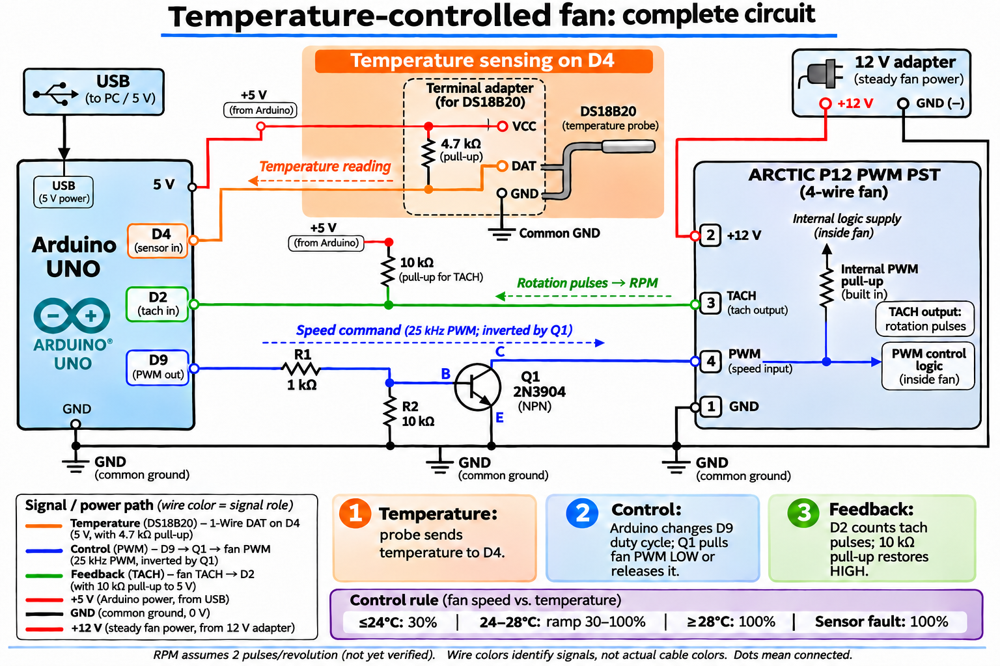

# Temperature-Controlled Cooling System

An Arduino Uno prototype that adjusts a four-wire fan's PWM command based on temperature and reports fan RPM from tachometer pulses. The controller has been tested on a breadboard and is ready for enclosure design.

**Latest bench test · 24 November 2026.** The controller increased the fan command as the probe warmed and returned to its minimum as it cooled. Disconnecting the sensor data wire commanded full speed. Reconnecting it restored temperature control without a reset.

The [wiring guide](Docs/temperature-fan-wiring.md) explains the connections shown above. The [bench test record](Docs/Tests/2026-11-24-temperature-fan-integration/README.md) includes circuit photos, Serial Monitor screenshots and measured results.

## Bench controller behavior

| Temperature or sensor condition | Fan command |
| --- | --- |
| At or below 24 °C | 30% |
| Between 24 °C and 28 °C | Linear ramp from 30% to 100% |
| At or above 28 °C | 100% |
| Detected sensor fault | 100% |

These are provisional bench settings. Displayed RPM uses an unverified assumption of two tach pulses per turn. The PWM frequency is calculated at 25 kHz. Reference checks for RPM, PWM and temperature remain open.

## Documentation

- [Test plan and status](Docs/test-plan.md)
- [Initial temperature sensor test](Docs/Tests/2026-10-19-temperature-sensor/README.md)
- [Fan PWM test: notes, videos and Serial Monitor capture](Docs/Tests/2026-10-26-fan-pwm/README.md)
- [PWM and RPM test results](Docs/Tests/2026-11-21-fan-rpm/README.md)
- [PWM and tachometer wiring](Docs/fan-rpm-wiring.md)
- [Integrated controller wiring and schematic](Docs/temperature-fan-wiring.md)
- [Project logbook](Docs/Excel%20Files/Tempreture-controlled%20cooling%20system%20Logbook.xlsx)

## Firmware

- [Integrated temperature controller: sketch, setup and code guide](temperature_fan_controller/README.md)
- [Earlier temperature sensor test sketch](temperature_sensor/temperature_sensor.ino)
- [Earlier standalone fan test sketch](fan_test/fan_test.ino)
- [Earlier PWM and RPM test sketch](fan_rpm_test/README.md)

The integrated sketch targets the Arduino Uno R3 / ATmega328P and configures Timer1 directly. The setup guide lists the required libraries and the Serial Monitor settings.

## Next steps

Measure the hardware, plan intake and exhaust airflow, and model the enclosure in SolidWorks. After assembly, use a controlled heat load to test cooling and tune the temperature thresholds and minimum fan command.
